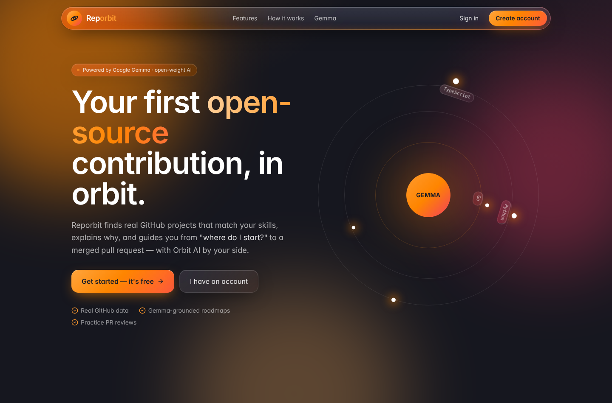
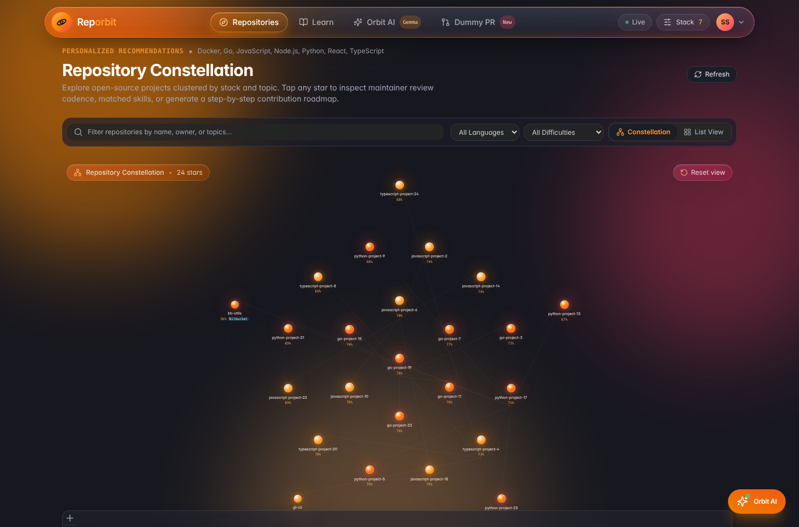
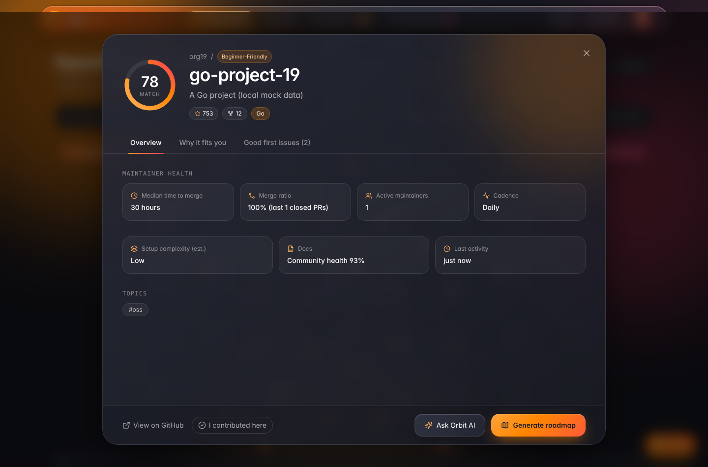
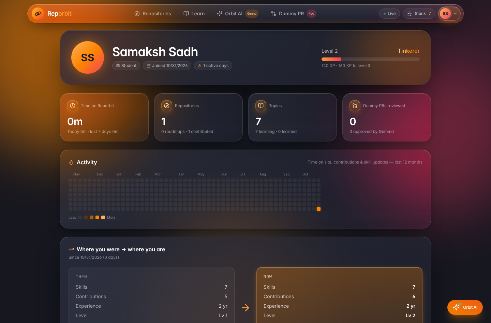
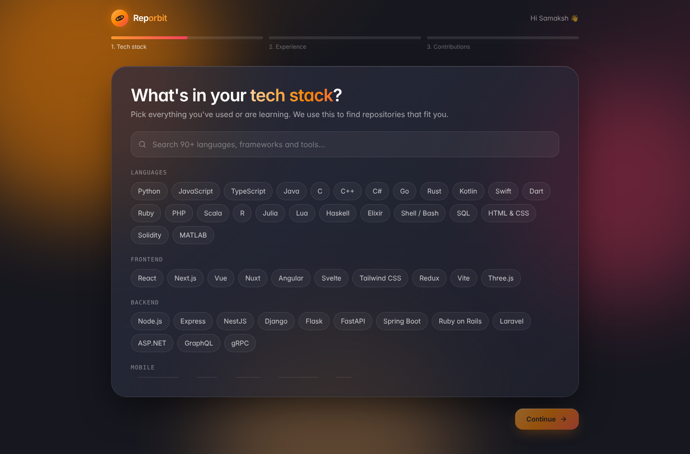

<div align="center">

# 🪐 Reporbit

### Your first open-source contribution, guided by Google Gemma.

Reporbit finds real open-source repositories that match your skills (GitHub, GitLab and Bitbucket), explains *why* they fit, writes a step-by-step contribution roadmap from each project's own docs, reviews your practice pull requests, and tracks your growth, with **Orbit AI**, a friendly Gemma-powered mentor, by your side.

**Team Avengers** · Hacktoberfest Hack Day Hyderabad 2026 · Track 2: *Best Use of Gemma*




</div>

---

## ✨ What Reporbit does

| | Feature | What you get |
|---|---|---|
| 🌌 | **Repository Constellation** | Up to 24 real repos with open beginner issues from **GitHub, GitLab and Bitbucket**, arranged in rings: best match at the centre. |
| 🎯 | **Transparent match score** | Stack overlap, difficulty fit, activity and docs quality, with each part shown. Maintainer metrics (median time to merge, merge ratio) come from real PRs; anything we can't measure says *"Not measured"*. |
| 🗺️ | **Gemma roadmaps** | Gemma reads the repo's README and CONTRIBUTING and writes your path to a first PR. Commands and file names that aren't in those docs are removed. |
| 💬 | **Orbit AI** | A mentor that talks like a person: casual chat, slang, Hinglish. It answers from the repo's docs with cited sources. |
| 🔍 | **Dummy PR** | Paste code (up to 3,000 lines) or upload a whole project **.zip**; Gemma reviews it like a maintainer, file by file, with a verdict, line-by-line comments (bug / issue / suggestion / style) and fixes. Code is never executed. |
| 📈 | **Profile & growth** | Time on Reporbit, repos explored and contributed to, topics, a 12-month heatmap, a growth chart, and *where you were → where you are*. |

<table>
<tr>
<td></td>
<td></td>
</tr>
<tr>
<td></td>
<td></td>
</tr>
</table>

<sub>Screenshots from a local test build of v3. The repository data and the chat reply shown come from mock services, not live GitHub or Gemma output.</sub>

---

## 🧠 Where Google Gemma does the core work

| Feature | API | Gemma's job |
|---|---|---|
| Contribution roadmap | `GET /api/repositories/:id/roadmap` | Turns README and CONTRIBUTING into a 5-step plan, then the server strips invented files and commands |
| Orbit AI | `POST /api/chat` | Conversational mentor that cites the repo's docs; repo text is treated as untrusted |
| Dummy PR review | `POST /api/review` | Code review: bugs, security, edge cases and fixes; invalid line numbers are dropped and code is never executed |
| Onboarding & growth | `/api/me/skills/extract`, `/api/me/growth/story` | Skill extraction from free text; growth story from real data |

**If Gemma is unreachable, Reporbit says so.** It never shows a canned "AI" answer.

- **Model:** Google **Gemma 3** (e.g. `gemma3:4b` via Ollama, or `gemma-4-26b-a4b-it` / `gemma-3-27b-it` via Google AI Studio, depending on what your key can access). The exact ID is shown in `/api/health` and on every AI response.
- **Model license:** [Gemma Terms of Use](https://ai.google.dev/gemma/terms). The code's MIT license does **not** relicense the model.

---

## 🗂️ Repository layout

Every stage of the hack night is kept, so you can see how Reporbit evolved:

| Folder | Version | What it is |
|---|---|---|
| [`v0/`](v0) | MVP | *Repo Match*: first prototype (Node + matching + AI helper) |
| [`v1/`](v1) | Orbit 1 | Node + PostgreSQL backend, Orbit React UI, GitHub discovery, Gemma roadmap & mentor |
| [`v2/`](v2) | Reporbit 2 | Landing page, email/password accounts, onboarding, liquid-glass UI, Dummy PR, casual Orbit AI |
| [`v3/`](v3) | Reporbit 3 | GitHub + GitLab + Bitbucket, ring constellation, profile page with heatmap & growth, caching for faster loads |
| [`v4/`](v4) | Reporbit 4 | Dummy PR accepts project .zip uploads (no 500-line limit), Gemma 4 support |
| [`v5/`](v5) | **Reporbit 5 (current)** | Light/Dark theme, Connect GitHub (verified contributions), Learn → tech stack, badge guide, instant GitHub repo search, personalised AI roadmaps, Connect-to-Orbit-AI, deletable chats, boot animation |

`render.yaml` deploys **v5**.

---

## 🚀 Run v5 locally

Requirements: **Node 20+**, **PostgreSQL 13+**, and Gemma via **Ollama** or a **Google AI Studio** key.

```bash
cd v5/backend
cp .env.example .env      # set DATABASE_URL, Gemma settings, GITHUB_TOKEN (never commit .env)
npm install
npm run build:frontend    # compiles the React UI into backend/public
npm run migrate
npm run seed -- --demo
npm start                 # → http://localhost:4000
```

| Gemma option | `.env` |
|---|---|
| Local (Ollama) | `GEMMA_PROVIDER=ollama` · `GEMMA_MODEL=gemma3:4b` (run `ollama pull gemma3:4b`) |
| Hosted (AI Studio) | `GEMMA_PROVIDER=google` · `GEMMA_MODEL=gemma-4-26b-a4b-it` · `GOOGLE_API_KEY=…` |

Check that everything is up: `curl localhost:4000/api/health` should show `"database":"ready"` and `"gemma":"ready"`.

**Deploy:** Render → *New → Blueprint* → this repo. `render.yaml` builds the frontend and starts the backend from `v5/backend`.

---

## 🛠️ Tech stack

**Frontend:** React 18, TypeScript, Vite, Tailwind CSS, Framer Motion, React Flow
**Backend:** Node.js (built-in HTTP server, no framework), PostgreSQL (`pg`); scrypt password hashing, server-side sessions + CSRF
**AI:** Google Gemma via Ollama or the Gemini API
**Data:** GitHub REST API, GitLab API v4, Bitbucket API 2.0

Security: passwords hashed with scrypt; sessions in PostgreSQL (token hash only); CSRF on every write; every query scoped to the signed-in user; fixed API hosts (no SSRF); secrets only in `.env`.

---

## 👥 Team Avengers

Samaksh · Pratyush · Harsh · Varun

## 📄 License

Code: [MIT](LICENSE) · Model: Google Gemma under the [Gemma Terms of Use](https://ai.google.dev/gemma/terms)


## Deploy on Vercel (v6)
Import this repo in Vercel, set **Root Directory = `v6`**, add a Neon Postgres database (sets `DATABASE_URL`) and the env vars `GEMMA_PROVIDER`, `GEMMA_MODEL`, `GOOGLE_API_KEY`, `GITHUB_TOKEN`, `COOKIE_SECURE=true`. Every push to `v6/` redeploys automatically.
